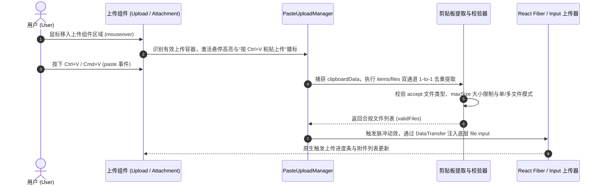

# NocoBase 插件：剪贴板悬停粘贴上传 (Plugin Paste Upload)

https://github.com/STlxx-lin/nocobase-plugin-paste-upload

在日常使用 NocoBase 录入业务数据、提交工单或上传凭证附件时，高频操作往往是**“微信/系统截图后上传”**或者**“从文件夹复制文件后上传”**。原生的附件上传流程需要先将截图另存为本地文件，再点击“上传附件”按钮在文件资源管理器中逐层寻找文件——操作链路繁琐且打断录入心流。

为了彻底解决这个高频交互痛点，我开发了这款轻量无侵入的效率增强插件 **`@nocobase/plugin-paste-upload`**。

核心体验非常直观：**将鼠标悬停在页面上任意附件或文件上传组件上方 -> 显示轻量虚线高亮与快捷键提示（`按 Ctrl+V 粘贴上传`） -> 直接按下 `Ctrl+V`（macOS 为 `⌘+V`） -> 自动提取剪贴板中的截图或文件并触发标准上传**。无需点击弹窗，零侵入即装即用。

---

## 🌟 核心特性

### 1. 🖱️ 悬停感知与即粘即传 (Hover-Aware Paste Upload)
- **无需点击聚焦**：只需将鼠标指针悬停在目标附件上传控件（`Upload.Attachment`、`Upload.Dragger`、标准 `Upload`）区域内，按下 `Ctrl+V` / `⌘+V` 即可直接把剪贴板中的文件推入当前字段；
- **智能文件名生成**：针对系统截图工具产生的无名/通用名图片（如 `image.png`），自动生成带毫秒级时间戳的规范文件名（如 `paste-20261027-102530-123.png`），避免多张截图同名覆盖；
- **微交互视觉反馈**：悬停时右上角平滑浮现快捷键提示徽标，粘贴瞬间触发蓝色脉冲涟漪动画，原生融入 Ant Design 5 视觉体系。

### 2. 🛡️ 剪贴板双通道精准去重与全局防重 (Smart Deduplication)
- **双通道消费池消重**：针对 Chromium / 现代浏览器在粘贴单张截图或单个复制文件时，`clipboardData.items` 与 `clipboardData.files` 同时返回两个不同引用 `File` 对象的底层特性，内置 1-to-1 待消费池精准比对算法，确保**粘贴一次只上传一份文件**；
- **全局单例事件锁**：跨 `@nocobase/client` 与 `@nocobase/client-v2` 共享 `globalThis` 单例管理器与事件消费锁，彻底杜绝双包加载导致的重复触发。

### 3. 📏 严格遵循字段校验与单/多文件约束 (Validation & Constraints)
- **类型与大小拦截**：自动识别上传组件配置的 `accept`（支持 `.png,.pdf` 后缀及 `image/*` 等 MIME 通配符）与 `maxSize` 大小限制，不合规文件自动拦截并弹出友好提示；
- **单文件模式自适应**：当上传字段为单文件模式时，若一次性粘贴多个文件，自动截取首个合规文件上传并给出温和提示；
- **禁用与只读保护**：自动跳过处于 `disabled` 或 `readonly` 状态的上传容器，确保业务表单权限安全。

### 4. 📝 纯文本与输入态安全隔离 (Input Isolation)
- **绝不干扰正常打字**：当焦点位于 `<input>`、`<textarea>` 或富文本编辑器（`contenteditable`）内部，或者剪贴板中仅包含纯文本/HTML 内容时，插件自动静默放行，不影响系统原有的任何文本复制粘贴行为。

### 5. 🔌 双端架构零侵入兼容与中英双语 (Dual-Client & i18n)
- **双架构无缝支持**：同时适配 NocoBase 经典客户端（`@nocobase/client`）与 Modern Client（`@nocobase/client-v2`），通过高阶组件增强与全局 DOM 委托双保险机制，使普通页面、弹窗（Modal）、抽屉（Drawer）及子表格内的附件字段全部即装即用；
- **内置中英双语**：完整支持 `zh-CN` 与 `en-US` 多语言包，自动跟随系统语言切换。

---

## 🔄 交互工作流转图



---

## 🚀 安装与使用指南

### 方式 1：通过 NocoBase 插件管理器界面直接上传安装（推荐）

1. 前往 GitHub Releases 下载最新版本的 `.tgz` 压缩包（见文末下载链接）；
2. 进入 NocoBase 后台 **插件管理器 (Plugin Manager)** -> 点击 **添加插件 (Add plugin)** -> 上传 `plugin-paste-upload-v0.1.0.tgz` 并启用即可。

### 方式 2：源码构建安装

将插件放置于 `packages/plugins/@nocobase/plugin-paste-upload` 目录下：

```bash
# 1. 编译构建并打包
yarn build @nocobase/plugin-paste-upload --tar

# 2. 启用插件
yarn nocobase pm enable @nocobase/plugin-paste-upload
```

---

## 📦 项目开源地址与 Release 下载

- **GitHub 仓库**：[https://github.com/STlxx-lin/nocobase-plugin-paste-upload](https://github.com/STlxx-lin/nocobase-plugin-paste-upload)
- **最新版本**：`v0.1.0`
- **直接下载 Release 安装包**：
  - [plugin-paste-upload-v0.1.0.tgz](https://github.com/STlxx-lin/nocobase-plugin-paste-upload/releases/download/v0.1.0/plugin-paste-upload-v0.1.0.tgz)
  - [plugin-paste-upload-v0.1.0.zip](https://github.com/STlxx-lin/nocobase-plugin-paste-upload/releases/download/v0.1.0/plugin-paste-upload-v0.1.0.zip)

欢迎大家在实际业务系统中使用体验！如果有任何建议、需求或问题，欢迎在 GitHub Issue 或本帖下方留言交流！
